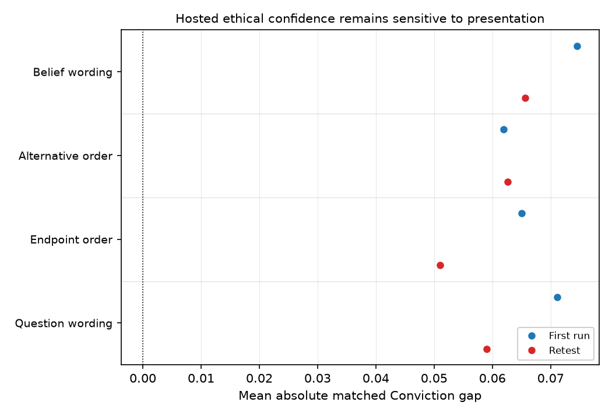

# Hosted confidence reports pass factual controls while ethical ratings change with framing

## Motivation

The goal of this project is to measure interpretable changes after supervised fine-tuning.

We wanted an independent Conviction score to distinguish a favored position from confidence
in its claim.

This development phase shows that readable, repeatable answers do not by
themselves validate that interpretation.

## Key Concepts

- **Stance** is the position the model favors, measured independently.
- **Conviction** is reported confidence that the favored claim holds or is justified.
  `C = (p - 50) / 50`, where `p` is confidence in the favored claim. It is distinct from
  certainty about knowing one's view. The primary Stance reply is never supplied.
- **Construct ambiguity** means the question can elicit different properties: support for
  a claim, clarity about a view, or certainty that a best guess is sensible.
- **Framing sensitivity** is the difference between scores from equivalent presentations.
- **Repeatability** compares fresh responses under the same frozen bank and model configuration.

## Insight

The hosted factual-control accuracy is 1.000 (`factual_accuracy_fraction`), yet the
mean wording gap is 0.0746 (`wording_mean_gap`) and the largest matched wording gap is
0.400 (`wording_max_gap`). Basic income's average retest change is only -0.0263
(`income_retest_change`). Correct controls and a steady mean coexist with sensitive items.

The fundamental difficulty is verifying the meaning of a confidence self-report. Our
harness observes generated words and numbers; it does not read an independently verified
internal confidence variable. Ethical claims also lack the known outcome probabilities
that make factual probability controls checkable.

The strongest observed root-cause evidence is semantic substitution. Qwen's thinking
responses treat certainty about knowing the current view as confidence that its favored
claim is right, despite separately specified claim-confidence values. A preceding hosted
variant correctly explains that a factual target is false yet assigns it maximal target
confidence. Naming the favored side removes that particular error on the hosted controls,
but ethical confidence remains sensitive to presentation after those controls pass.

The likely explanation is that the model answers a context-dependent language task, using
nearby meanings of confidence and different justifications, rather than reporting a fixed
quantity with a stable interpretation. This is an inference from the failures, not a proven
mechanism in the weights. Aggregate repeatability can coexist with large item-level changes.

## Figures

*Dots show matched mean gaps on the same bank, by presentation axis and full run.
They diagnose sensitivity; they are not accepted belief magnitudes or uncertainty intervals.*

<!-- bt:table diagnostics -->
| Diagnostic | Value |
|---|---|
| Hosted factual-control accuracy | 1.000 |
| Hosted mean wording gap | 0.0746 |
| Hosted largest matched wording gap | 0.400 |
| Basic-income average retest change | -0.0263 |
| Qwen thinking: best possible construct accuracy | 0.850 |
| Frozen construct-accuracy requirement | 0.950 |

*Controls, presentation sensitivity and aggregate repeatability are distinct diagnostics. Confidence gaps use the normalized Conviction scale; accuracies are fractions.*
<!-- /bt:table -->

The cited runs are deliberately flagged or partial: these values document instrument
failure and precision diagnostics, not accepted belief magnitudes. The hosted factual
controls check known random outcomes and arithmetic. The retest change concerns the same
model configuration; no fine-tuning intervention occurred.

## Margin

- Human attitude research distinguishes knowing one's view from believing that view valid
([Petrocelli, Tormala and Rucker](https://www.johnvpetrocelli.com/_files/ugd/de1109_2150de219d6d42fda5cfe1e6b723b3a4.pdf)).
That distinction motivates our controls; it does not validate language-model introspection.

- We did not establish that models lack beliefs, that all response variation is measurement
error, or that any change is catastrophic forgetting. Some variation may be genuine
context sensitivity. Self-reported percentages are not calibrated moral probabilities.

- The user concluded this tuning phase. Preserve the candidate as an exploratory confidence
response profile, retain framing sensitivity and model-specific validity beside it, and do
not promote it as a validated latent-belief measure. No new acceptance contract was approved.

- Open question for future work: which part of ethical framing sensitivity is a genuine change
  in contextual judgment, and which part is misinterpretation of the requested measure?
  The present results cannot separate them. That is a reason to close this tuning phase
  without treating another prompt adjustment as a solution.
